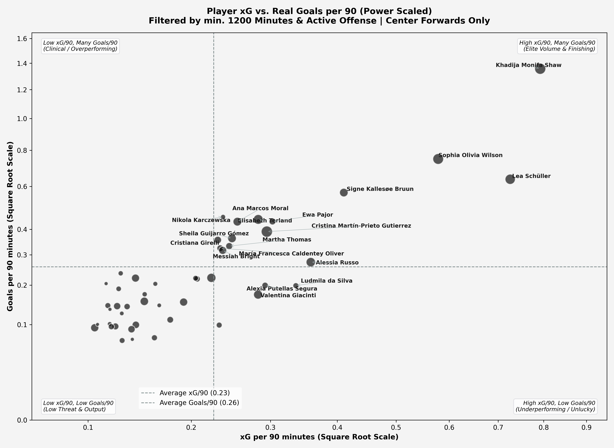
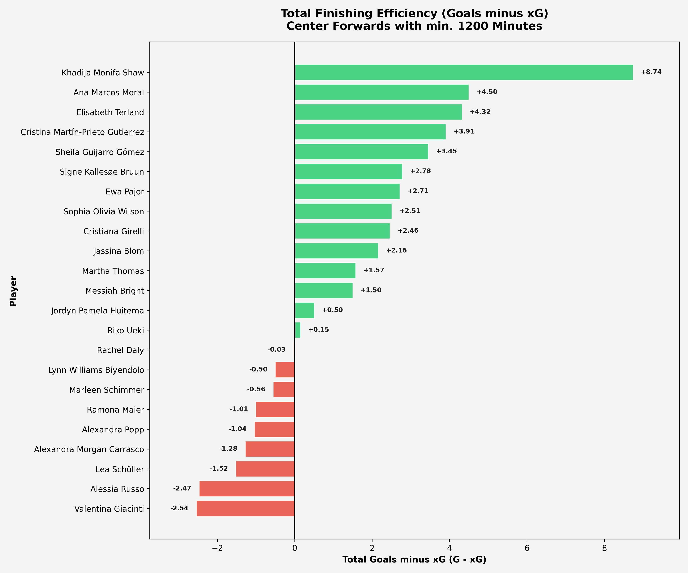
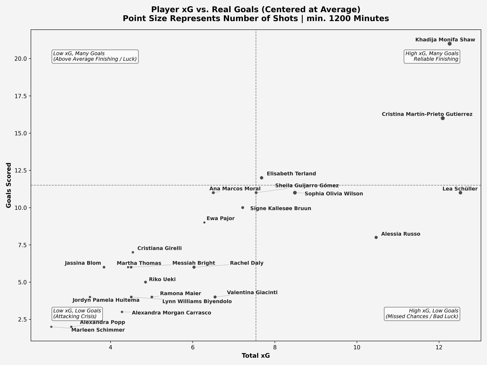

# Women's Football Scouting: Advanced Finishing & xG Analysis

An end-to-end data scouting repository analyzing attacking output, chance quality, and finishing efficiency for **Center Forwards** across women's football competitions using the StatsBomb open event data framework.

---

## 📌 Project Overview & Objectives

Relying exclusively on raw goal tallies introduces selection bias driven by team dominance, finishing streaks, or low shot volumes. This scouting pipeline isolates repeatable attacking value by evaluating:
- **Expected Goals (xG) vs. Actual Goals**: Benchmarking high-volume generators against clinical finishers.
- **Finishing Efficiency ($G - xG$)**: Pinpointing clinical overperformers versus strikers experiencing temporary negative variance.
- **Per 90 Normalization via Event Parsing**: Calculating exact pitch time from match substitution events instead of imprecise static 90-minute assumptions.

---

## 🛠️ Data Pipeline & Methodology

1. **Exact Playing Time Calculation (`src/player_minutes.py`)**:
   - Parses player participation and substitution actions (`type == 'Substitution'`) to establish exact on-pitch minutes for starters and substitutes.
   - Generates `data/player_total_minutes.csv` to serve as a fast local lookup table.
2. **Scouting Summary Aggregation (`src/build_forward_summary.py`)**:
   - Filters event-level shot attempts for center forwards and aggregates goals, shots, and cumulative xG.
   - Produces `data/forward_scouting_summary.csv`, allowing visualization scripts to run instantly without parsing massive event dumps.
3. **Scouting Sample Thresholds**:
   - **Position**: `Center Forward`
   - **Sample Size**: Minimum 1,200 minutes played to capture regular starters (including high-impact forwards like Khadija Shaw).
   - **Attacking Activity**: Minimum 30 total shots or $xG \ge 0.1$ per 90.
4. **Data Visualization Design**:
   - **Power / Square Root Scaling**: Applied to normalized per-90 metrics to declutter dense mid-range clusters while accommodating elite outliers.
   - **Automated Label Placement**: Uses `adjustText` with directional pointers to prevent label overlapping.
   - **Quadrant Benchmarking**: Segmented via sample averages across chance creation and conversion.

---

## 📊 Key Visualizations & Scouting Insights

### 1. Normalized Quadrant Analysis ($xG \text{ per } 90 \text{ vs. } \text{Goals per } 90$)


- **Generational Outlier**: **Khadija Monifa Shaw** dominates both dimensions (~0.78 xG/90 and >1.35 Goals/90), representing the highest threat density in the dataset.
- **Elite Chance Generation**: **Sophia Olivia Wilson** and **Lea Schüller** consistently access high-quality scoring opportunities, anchoring top-tier attacking units.
- **Clinical Finishers**: **Ana Marcos Moral**, **Elisabeth Terland**, and **Ewa Pajor** demonstrate above-average conversion rates relative to their expected metrics.

---

### 2. Finishing Delta ($G - xG$)


- **Top Overperformers**: **Khadija Monifa Shaw** (+8.74), **Ana Marcos Moral** (+4.50), and **Elisabeth Terland** (+4.32) lead the sample in converting difficult chances.
- **Recruitment Targets / Value Plays**: Strikers with negative deltas like **Alessia Russo** (-2.47) and **Valentina Giacinti** (-2.54) maintain strong underlying chance involvement. In professional scouting, high underlying xG with depressed finishing delta often flags buy-low transfer opportunities due for positive mean regression.

---

### 3. Cumulative Season Output (Total xG vs. Goals)


- Provides absolute volume context to verify that per-90 efficiency is sustained over substantial match samples.
- Highlights sustained contributors such as **Cristina Martín-Prieto Gutierrez** and **Elisabeth Terland** reaching double-digit goal returns.

---

## 📁 Repository Structure

```text
├── data/
│   ├── forward_scouting_summary.csv   # Aggregated center forward metrics
│   └── player_total_minutes.csv       # Pre-computed playing time cache
├── results/
│   ├── best_xg_performers.png         # Finishing efficiency bar chart (G - xG)
│   ├── xg_vs_goals_per90.png          # Power-scaled per-90 quadrant scatter plot
│   └── xg_vs_goals.png                # Total volume quadrant scatter plot
├── src/
│   ├── best_xG_performers.py          # Script generating G - xG bar chart
│   ├── build_forward_summary.py       # Aggregation pipeline script
│   ├── calculate_minutes.py           # Playing time extraction runner
│   ├── goals_vs_xG_per90.py           # Script generating per-90 scatter plot
│   ├── goals_vs_xG.py                 # Script generating total volume scatter plot
│   └── player_minutes.py              # Minute calculation module
├── .gitignore
└── README.md