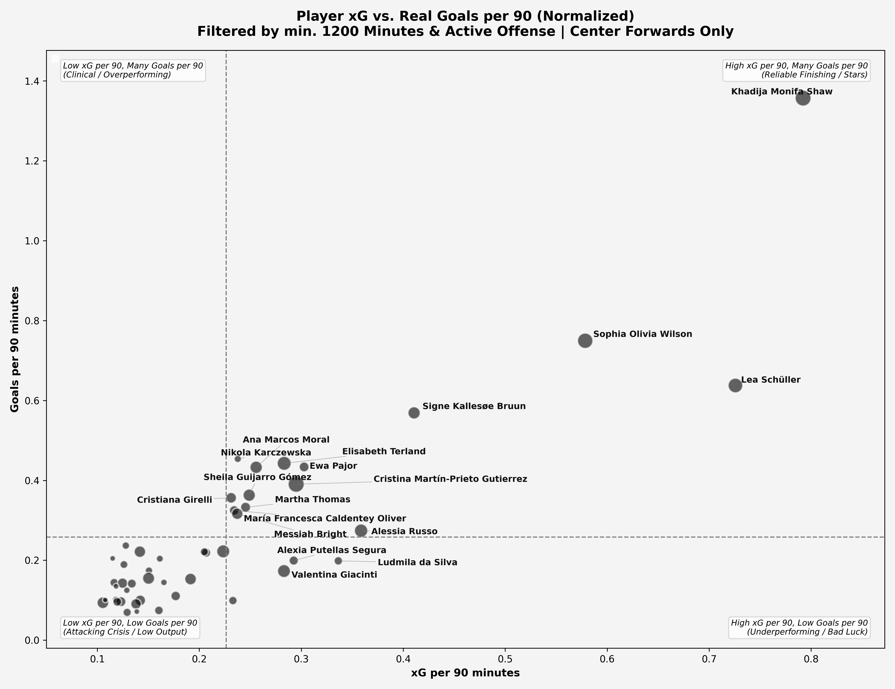

# Women's Football Scouting: Advanced Finishing & xG Analysis

An end-to-end data scouting project analyzing attacking performance and finishing efficiency for **Center Forwards** across women's football competitions using StatsBomb open-data event format.

---

## 📌 Project Overview & Objectives

Traditional goal statistics often disguise player quality due to team dominance, variance, or luck. This project decouples finishing luck from chance creation by evaluating:
- **Expected Goals (xG) vs. Actual Goals**: Evaluating volume and shot quality.
- **Finishing Efficiency ($G - xG$)**: Pinpointing clinical finishers vs. underperforming strikers.
- **Per 90 Normalization via Event Mining**: Accurately calculating minutes played from substitutions and match actions instead of defaulting to a misleading static 90-minute assumption.

---

## 🛠️ Data Pipeline & Methodology

1. **Exact Playing Time Calculation (`player_minutes.py`)**:
   - Parses match actions and substitution events (`type == 'Substitution'`) to track true pitch time for both starting players and late substitutes.
   - Outputs a persistent cache (`player_total_minutes.csv`) to decouple expensive minute recalculations from visualization workflows.
2. **Scouting Filters (Sample Reliability)**:
   - **Position**: `Center Forward`
   - **Playing Time**: Minimum 1,800 minutes played to eliminate small-sample noise and non-regular starters.
   - **Shot Volume**: Minimum 30 shots or minimum $xG \ge 0.1$ per 90.
3. **Automated Label Placement**:
   - Integrated `adjustText` with directional pointer lines to prevent overlapping labels and maintain presentation-grade visual standards.

---

## 📊 Key Visualizations & Findings

### 1. Striker Quadrant Analysis ($xG \text{ per } 90 \text{ vs. } \text{Goals per } 90$)


- **The Outlier / Elite Volume**:
  - **Khadija Monifa Shaw** stands out as the league's most dominant attacker, creating elite shot quality per 90 while consistently outscoring her expected output.
  - **Lea Schüller** and **Sophia Olivia Wilson** rank among the highest volume creators in the sample, consistently sustaining threats against deep blocks.
- **Tactical Roles**:
  - Quadrants clearly distinguish between high-volume primary scorers, clinical poachers operating on lower volume, and strikers currently in an attacking drought.

---

### 2. Finishing Efficiency (Diverging Bar Chart: $G - xG$)


- **Clinical Overperformers ($G > xG$)**:
  - **Ana Marcos Moral** (+4.50) and **Elisabeth Terland** (+4.32) exhibit elite conversion rates from low-to-medium difficulty chances.
- **Market Opportunity / Underperformers ($G < xG$)**:
  - **Alessia Russo** and **Valentina Giacinti** register negative finishing deltas despite generating strong baseline underlying numbers.
  - *Scouting Insight*: Often indicative of variance or temporary finishing slumps. Players in this category represent undervalued transfer targets primed for positive regression to the mean.

---

## 📁 Repository Structure

```text
├── player_minutes.py            # Exact playing time calculation module
├── goals_vs_xG.py               # Quadrant scatter plot (Total xG vs Goals)
├── goals_vs_xG_per90_2.py       # Normalized per-90 quadrant scatter plot
├── best_xG_performers.py        # Diverging bar chart (Finishing efficiency G - xG)
├── player_total_minutes.csv     # Pre-calculated minutes played cache
├── clean_match_events_lean.csv  # Cleaned match event dataset
└── README.md                    # Project documentation